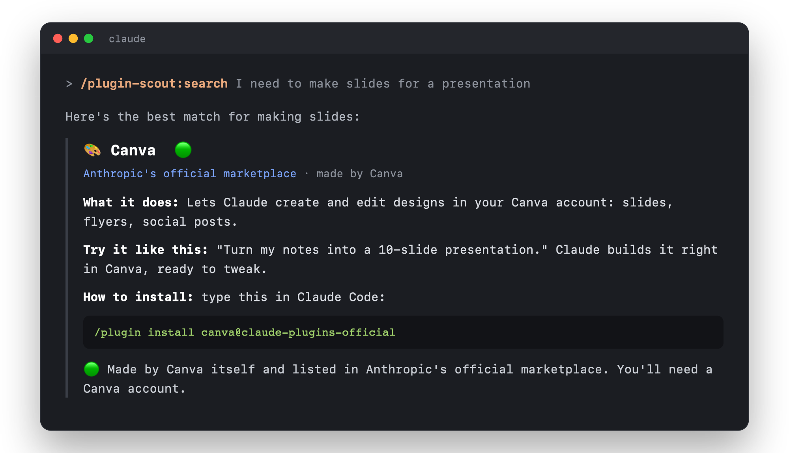

# 🧩 plugin-scout

🇬🇧 [English](README.md) · 🇩🇪 **Deutsch**

Ein Claude-Code-Plugin, das gute **andere Plugins** für dich findet, prüft und so erklärt, dass man sie sofort versteht. Es antwortet in deiner Sprache: Schreibst du Deutsch, antwortet es auf Deutsch.

<p align="center"></p>

## Was es kann

| Befehl | Was passiert |
|---|---|
| `/plugin-scout:start` | **Einstiegs-Guide.** Du sagst, wofür du Claude nutzt, und bekommst die wichtigsten Plugins dafür: Must-haves, Nice-to-haves und eine Überraschung. Dein Use Case wird gespeichert. |
| `/plugin-scout:search <Wunsch>` | Sucht gezielt Plugins, z. B. `/plugin-scout:search Präsentationen bauen`. Du bekommst 3–5 Vorschläge. |
| `/plugin-scout:project` | **Schaut sich dein aktuelles Projekt an** (Webseite, App, Uni-Notizen, …) und sagt dir, welche Plugins ihm wirklich helfen würden, auch weniger bekannte Geheimtipps. Fehlt nichts, sagt es das ehrlich. |
| `/plugin-scout:check <Plugin>` | **Sicherheits-Check** vor dem Installieren: Was macht es auf deinem Rechner? Sind die Sterne echt? Am Ende gibt's eine Ampel 🟢🟡🔴. |
| `/plugin-scout:compare <A> <B>` | Vergleicht zwei Plugins und sagt, welches besser zu dir passt. |
| `/plugin-scout:cleanup` | Zeigt, welche deiner Plugins doppelt, veraltet oder unbenutzt sind. |
| `/plugin-scout:weekly` | Neue, gute Plugins der letzten 7 Tage, passend zu dir, plus 1–2 aus ganz anderen Bereichen. |
| `/plugin-scout:setup-weekly` | Richtet dein **automatisches Weekly** ein (jeden Montag als GitHub-Issue). |

Du kannst auch einfach fragen: *„Gibt's ein Plugin für Lernkarten?“* oder *„Ist Plugin X sicher?“*

Jedes Plugin wird als kleine Karte erklärt, mit Ampel 🟢🟡🔴. plugin-scout **installiert und löscht nie selbst etwas**, du entscheidest.

## Weekly, das dazulernt

`/plugin-scout:setup-weekly` legt dir ein **privates** GitHub-Repo an (z. B. `dein-name/plugin-scout-daten`) und eine Routine in der Cloud. Jeden Montag schreibt Claude das Weekly dort als **Issue** hinein, jedes Plugin als eigenen Kommentar. **Reagier mit 👍 oder 👎**, dann zeigt dir das nächste Weekly mehr von dem, was dir gefällt. Was du schon gesehen hast, kommt nicht nochmal.

Dein Profil (Use Case) liegt in diesem privaten Repo, nicht hier.

## Was es ausführt und wohin deine Daten gehen

plugin-scout besteht nur aus Anleitungen für Claude (Skills und Befehle). Keine Skripte, kein kompilierter Code, keine Pakete zum Installieren.

- **Deine Plugins lesen:** Damit nichts doppelt empfohlen wird, liest Claude `~/.claude/plugins/installed_plugins.json` und `known_marketplaces.json` auf deinem Rechner. `/plugin-scout:cleanup` durchsucht außerdem deine lokalen Claude-Code-Chatverläufe nach Plugin-Namen, um zu schätzen, welche Plugins du wirklich benutzt. Davon wird nichts hochgeladen.
- **Projekt-Scan:** `/plugin-scout:project` schaut sich den aktuellen Ordner auf deinem Rechner an: Es zählt die Dateien nach Typ und liest kleine Config-Dateien wie `package.json`. Geheime Dateien (`.env`, Schlüssel) liest es nie, und es verschickt weder Code noch Datei- oder Projektnamen. In Suchen landen nur allgemeine Begriffe wie "react" oder "testing". Eine kurze Zusammenfassung wird lokal in `~/.claude/plugin-scout/projekte/` gespeichert.
- **Lernen (lokal):** plugin-scout merkt sich in `~/.claude/plugin-scout/vorschlaege.txt`, was es dir vorgeschlagen hat, und schaut später nach, ob du es installiert, behalten oder wieder entfernt hast. So schlägt es immer mehr das vor, was du wirklich nutzt. Davon wird nichts verschickt. Nur eine kurze Zusammenfassung (Themen und Plugin-Namen) kommt in dein Profil und mit dem Weekly in dein eigenes privates Repo.
- **Suchen:** Claude nutzt die GitHub-CLI (`gh`), die Websuche und Webseiten. Verschickt werden nur Suchbegriffe und Namen öffentlicher Repos.
- **Dein Profil** (Use Case, Sprache, Interessen, die du nennst) liegt lokal in `~/.claude/plugin-scout/profil.md`. Wenn du das Weekly einrichtest, auch in **deinem eigenen privaten** GitHub-Repo.
- **Weekly (optional):** `/plugin-scout:setup-weekly` fragt, bevor es ein privates Repo in deinem GitHub-Konto und eine geplante Claude-Routine anlegt, die das Weekly dort als Issue postet.
- **Niemals:** Es installiert oder löscht keine Plugins, ändert keine Einstellungen und hat keinen eigenen Server. An den Autor geht nichts.

Alle Details: [Privacy Policy / Datenschutz](PRIVACY.md)

## Installieren

In Claude Code eintippen:

```
/plugin marketplace add Alessandro081206/plugin-scout
/plugin install plugin-scout@plugin-scout
```

Danach `/plugin-scout:start` eintippen.

**Für dich beim Entwickeln** (lokaler Ordner statt GitHub):

```
/plugin marketplace add ~/Projekte/plugin-scout
/plugin install plugin-scout@plugin-scout
```

Nach Änderungen am Plugin: `/plugin` → Marketplace `plugin-scout` → **Update**, dann Claude neu starten.

## Testen

- Schnell ausprobieren: `claude --plugin-dir ~/Projekte/plugin-scout`
- Aufbau prüfen: läuft automatisch auf GitHub bei jedem Hochladen (`.github/workflows/tests.yml`)
- Verhalten prüfen: `claude plugin eval . --allow-tools Bash WebFetch WebSearch` (Tests in `evals/`, kostet etwas Claude-Nutzung, ca. 1 $ für alle drei)

## Selbst erweitern

- Neuer Befehl: eine weitere `.md`-Datei in `commands/` anlegen. Der Dateiname wird zum Befehl.
- Wie gesucht, bewertet und erklärt wird, steht in `skills/plugin-scout/SKILL.md`.
- Der Auftrag für die Montags-Routine steht in `vorlagen/weekly-routine.md`.

## Haftungsausschluss

Die Ampel 🟢🟡🔴 ist eine **schnelle, automatische Einschätzung** anhand öffentlicher Infos (Dateien, README, Sterne, Aktivität). Sie ist **keine Sicherheitsprüfung und keine Garantie**. Plugins stammen von Dritten. plugin-scout installiert nie selbst etwas. Was du installierst und benutzt, entscheidest du selbst und auf eigenes Risiko. Siehe [Lizenz](LICENSE): Die Software wird "wie besehen" bereitgestellt, ohne jede Gewährleistung.

## Lizenz

[MIT](LICENSE) © 2026 Alessandro081206
