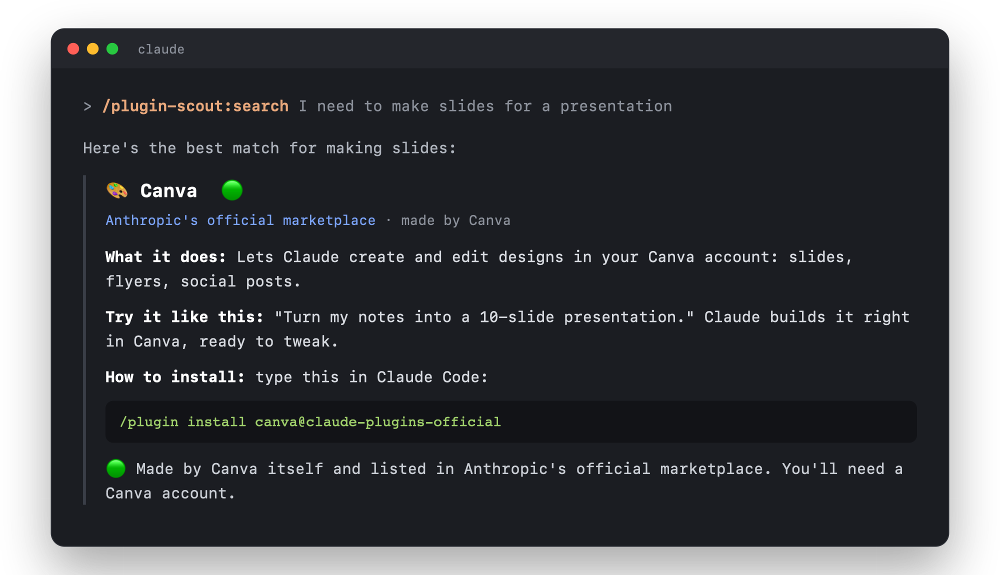

# 🧩 plugin-scout

🇬🇧 **English** · 🇩🇪 [Deutsch](README.de.md)

A Claude Code plugin that finds good **other plugins** for you, checks them for safety, and explains them so anyone can understand them, no tech jargon.

> Made for people who aren't professional developers. plugin-scout replies **in your language**: write in English, get English; write in German, get German.

<p align="center"></p>

## What it does

| Command | What happens |
|---|---|
| `/plugin-scout:start` | **Getting-started guide.** Tell it what you use Claude for and get the most important plugins: must-haves, nice-to-haves and one surprise. Your use case is saved. |
| `/plugin-scout:search <wish>` | Searches for plugins, e.g. `/plugin-scout:search build presentations`. You get 3–5 suggestions. |
| `/plugin-scout:project` | **Looks at the project you're working on** (website, app, thesis notes, …) and tells you which plugins would really help it, including lesser-known gems. If nothing is missing, it says so. |
| `/plugin-scout:check <plugin>` | **Safety check** before installing: What does it do on your computer? Are the GitHub stars real? Ends with a traffic light 🟢🟡🔴. |
| `/plugin-scout:compare <A> <B>` | Compares two plugins and tells you which one fits you better. |
| `/plugin-scout:cleanup` | Shows which of your plugins are duplicates, outdated or unused. |
| `/plugin-scout:weekly` | New, good plugins from the last 7 days that match you, plus 1–2 from completely different areas. |
| `/plugin-scout:setup-weekly` | Sets up your **automatic weekly** (every Monday as a GitHub issue). |

You can also just ask: *"Is there a plugin for flashcards?"* or *"Is plugin X safe?"*

Every plugin is shown as a small card with a traffic light 🟢🟡🔴. plugin-scout **never installs or removes anything by itself**. You decide.

## A weekly that learns

`/plugin-scout:setup-weekly` creates a **private** GitHub repo just for you (e.g. `your-name/plugin-scout-daten`) and a cloud routine. Every Monday it posts the weekly there as an **issue**, with each plugin as its own comment. **React with 👍 or 👎** and the next weekly shows more of what you like. Plugins you've already seen don't come back.

Your profile (use case) is stored in that private repo, not in this one.

## What it runs and where your data goes

plugin-scout is made only of instructions for Claude (skills and commands). No scripts, no compiled code, no packages to install.

- **Reading your setup:** to avoid recommending plugins you already have, Claude reads `~/.claude/plugins/installed_plugins.json` and `known_marketplaces.json` on your machine. `/plugin-scout:cleanup` also searches your local Claude Code chat logs for plugin names to estimate which plugins you actually use. Nothing from these files is uploaded.
- **Project scan:** `/plugin-scout:project` looks at the current folder on your machine: it counts files by type and reads small config files like `package.json`. It never reads secret files (`.env`, keys) and never sends code, file names or project names anywhere; only general terms like "react" or "testing" go into searches. A short summary is cached locally in `~/.claude/plugin-scout/projekte/`.
- **Learning (local):** plugin-scout keeps a small list of the plugins it suggested in `~/.claude/plugin-scout/vorschlaege.txt` and later checks whether you installed, kept or removed them, so it gets better at suggesting what you actually use. Nothing from it is sent anywhere; only a short summary (topics and plugin names) goes into your profile, and with the weekly into your own private repo.
- **Searching:** Claude uses the GitHub CLI (`gh`), web search and web pages to look up plugins. Only search terms and public repository names are sent.
- **Your profile** (use case, language, interests you mention) is saved locally in `~/.claude/plugin-scout/profil.md`. If you set up the weekly, it is also stored in **your own private** GitHub repo.
- **Weekly (optional):** `/plugin-scout:setup-weekly` asks before it creates a private repo on your GitHub account and a scheduled Claude routine that posts the weekly there as an issue.
- **Never:** it never installs or removes plugins, never changes your settings, and has no server of its own. Nothing is sent to the author.

Full details: [Privacy Policy](PRIVACY.md)

## Install

In Claude Code, type:

```
/plugin marketplace add Alessandro081206/plugin-scout
/plugin install plugin-scout@plugin-scout
```

Then run `/plugin-scout:start`.

## Try it locally

```
git clone https://github.com/Alessandro081206/plugin-scout.git
claude --plugin-dir ./plugin-scout
```

## Tests

- A structure check runs automatically on GitHub on every push (`.github/workflows/tests.yml`)
- `claude plugin eval . --allow-tools Bash WebFetch WebSearch` runs behavior tests from `evals/` (uses some of your Claude usage, about $1 for all three)

## Contributing

Found a bug or have an idea? [Open an issue](../../issues/new/choose). New commands are just `.md` files in `commands/`. How plugins are searched, rated and explained lives in `skills/plugin-scout/SKILL.md`.

## Disclaimer

The 🟢🟡🔴 ratings are a **quick, automated assessment** based on public information (files, README, stars, activity). They are **not a security audit and not a guarantee**. Plugins are made by third parties; plugin-scout never installs anything, and you decide what you install and use at your own risk. See the [license](LICENSE): the software is provided "as is", without warranty of any kind.

## License

[MIT](LICENSE) © 2026 Alessandro081206
